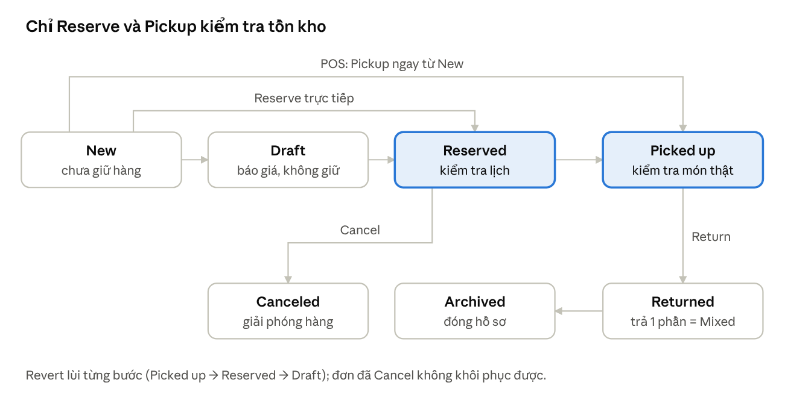

# Phân tích nghiệp vụ Booqable (ghiencafe)

2026-11-06 · Trung Do

## Tóm tắt

Booqable giải quyết tốt bài toán cốt lõi của cho thuê — không cho đặt trùng một món hàng — nhưng chỉ dựa trên lịch dự kiến, nên trả trễ và giao sớm phải do nhân viên tự xử lý.

- **Chống trùng lịch chặt:** chồng 1 phút cũng bị chặn khi Reserve; nối tiếp đúng ranh giới thì được; lead/lag time tạo khoảng đệm và được chụp vào đơn lúc đặt.
- **Điểm yếu lớn nhất:** đơn trả trễ vẫn cho đơn sau reserve; xung đột chỉ lộ ra lúc Pickup.
- **Kho mạnh:** số lượng hoặc từng serial, barcode, downtime bảo trì, kho tạm, nhiều chi nhánh; mọi thao tác gây thiếu hàng cho đơn tương lai đều bị chặn.
- **Giá linh hoạt:** theo giờ/ngày/tuần, bậc thang, tối thiểu, ruleset mùa vụ, bundle, cọc theo sản phẩm; nhưng đổi ngày không tự tính lại giá.
- **POS:** không có màn hình riêng; dùng đơn hàng + máy quét + giao ngay + thu tiền, đã chạy thành công.
- **Đổi ngành:** thiết bị điện tử và áo cưới phù hợp cao, ô tô trung bình (thiếu km, phí trễ), sách thấp (thiếu hội viên, phí trễ theo ngày).
- **Trước khi dùng thật:** kết nối cổng thanh toán và bật thu cọc ở checkout, cấu hình thuế, giờ hoạt động, Việt hóa, đổi chế độ báo giá dịch vụ sang giá cố định.

## Tổng quan hệ thống

Booqable là phần mềm SaaS cho thuê gồm hai ứng dụng web dùng chung một backend: back-office cho nhân viên và storefront cho khách đặt online.

| Thành phần | Địa chỉ | Công nghệ quan sát được | Ai dùng |
| --- | --- | --- | --- |
| Back-office | ghiencafe.booqable.com | SPA React, API `/api/boomerang/*` (JSON:API) + một số `/api/1/*` | Chủ shop, nhân viên |
| Storefront | ghiencafe.booqableshop.com | SPA React trong Shadow DOM, API `/api/4/*` (Shop Toolkit), `/api/boomerang/*`, `/api/1/cart` | Khách đặt online |
| Checkout | /checkouts/{cart_id} | Trang render từ server | Khách |
| App di động | iOS / Android | Không kiểm tra; quảng cáo Tap to Pay, quét barcode | Nhân viên tại quầy |

**Cách kiểm tra:** đăng nhập tài khoản trial, thao tác giao diện trong Chrome riêng điều khiển qua CDP. Phần lớn tình huống đặt lịch và kho được chạy bằng chính các API mà giao diện gọi, trong phiên đăng nhập, nên hành vi nghiệp vụ giống bấm nút. REA dùng để ghi network và phân tích bundle JavaScript.

**Bối cảnh tài khoản:** trial 14 ngày, tiền tệ VND, múi giờ GMT+7 (giờ được lưu dạng giờ địa phương nhưng gắn nhãn Z), storefront ở chế độ preview, chưa kết nối cổng thanh toán.

## Mô hình dữ liệu và vòng đời đơn hàng

Một đơn (Order) gắn với một khách và một khoảng thời gian; mỗi lần thêm hàng tạo một dòng tiền (Line) và một planning giữ hàng; khi giao/nhận theo serial thì sinh stock item planning. Chứng từ (Pro forma, Quote, Contract) và thanh toán (payment charges) treo trên đơn.

Đơn mới và Draft không giữ hàng. Reserve kiểm tra lịch và chặn nếu thiếu; Pickup kiểm tra món đang ở đâu thật. POS bỏ qua Reserve, giao ngay từ New.

## Đặt lịch và trùng lịch

Hệ thống giữ hàng theo **lịch dự kiến**, không theo vị trí thực tế của món hàng: trả trễ và nhận sớm không tự đẩy lịch, nên xung đột chỉ lộ ra lúc Pickup. Mỗi dòng hàng tạo một planning với khoảng giữ `reserved_from → reserved_till`; tồn kho tại một thời điểm = kho − planning chồng lấn − downtime + kho tạm. Kiểm tra chỉ xảy ra ở bước Reserve và khi sửa đơn đã reserve; Draft không giữ hàng.

Trừ khi ghi khác, sản phẩm thử có **1 cái** trong kho.

| # | Tình huống | Kết quả quan sát |
| --- | --- | --- |
| 1 | Đơn A trả 15:00, đơn B nhận đúng 15:00 cùng ngày | Cho phép: ranh giới không tính là trùng |
| 2 | B chồng A 1 giờ / 1 phút | Chặn khi Reserve (422 `items_not_available`, reason `shortage`) |
| 3 | Lag time 2h (dọn dẹp sau lượt thuê) | Máy bị khóa thêm 2h sau giờ trả: B nhận sau 1h bị chặn, sau đúng 2h được |
| 4 | Lead time 2h (chuẩn bị trước) | Khóa thêm 2h trước giờ nhận; đơn trả vào khung đó bị chặn |
| 5 | Đổi hoặc tắt buffer khi đã có đơn | Buffer được chụp vào planning lúc đặt: đơn cũ giữ buffer cũ |
| 6 | Trả trễ: A quá hạn chưa trả, đặt B ngày hôm sau | B vẫn reserve được; Pickup B bị chặn (`already_started`). Không có phí trễ tự động |
| 7 | Nhận sớm: giao hôm nay cho đơn lịch ngày 15 | Lịch vẫn giữ ngày 15; khoảng trống ở giữa vẫn cho đặt, Pickup mới bị chặn |
| 8 | Trả sớm (đơn 20–25, trả ngày 20) | Phần còn lại giải phóng ngay; giá không tự giảm |
| 9 | Gia hạn đè đơn sau / dời lịch vào đơn khác | Chặn; gia hạn sát ranh giới thì được |
| 10 | Giá sau khi gia hạn | Không tự tính lại. Giao diện hỏi “Recalculate prices?”; bấm thì 1 day 100k → 2 days 200k |
| 11 | Hủy đơn / Revert về Draft | Giải phóng hàng ngay; đơn đã hủy không khôi phục được |
| 12 | Draft được lưu khi thiếu hàng, sau đó người khác giữ mất | Draft → Reserve bị chặn |
| 13 | Shortage limit = 1 (cho bán vượt 1 cái) | Trong giới hạn: cảnh báo, cần `confirm_shortage`; mọi đơn chồng lấn gắn cờ shortage. Vượt giới hạn: chặn |
| 14 | Số lượng: kho 3, đơn 1 lấy 2, đơn 2 xin 2 | Chặn, báo thiếu 1; xin đúng 1 thì được |
| 15 | Storefront tại các thời điểm trên | Cùng một cách tính: đang giữ hoặc trong buffer hiện 0; đơn bán vượt hiện `available = -1`; `plannable` = còn lại + shortage limit |
| 16 | Cách tính giá theo ngày | Làm tròn lên: 2 ngày 6 giờ = 3 ngày |
| 17 | Đơn đặt online | Vào thẳng Reserved, gắn tag WEBSHOP, tự tạo khách, không cần duyệt |

## Quản lý kho

Kho được bảo vệ chặt: mọi thao tác làm thiếu hàng cho đơn tương lai (rút kho, tạo downtime) đều bị chặn với thông báo “This will create shortage for running or future orders”.

| Chức năng | Cách hoạt động quan sát được |
| --- | --- |
| Theo số lượng (bulk) | Nhập/xuất bằng stock adjustment (kèm giá mua, ngày mua). Không đổi được sang serial sau khi tạo |
| Theo từng món (trackable) | Mỗi món có mã serial duy nhất (đặt trùng bị từ chối). Lúc đặt chỉ cần “1 cái bất kỳ”, chọn món cụ thể lúc giao |
| Đặt đích danh serial | `book_stock_items`: hai đơn cùng giờ cùng một serial thì đơn sau bị chặn; vẫn đặt được “1 cái bất kỳ” nếu còn món khác |
| Giao serial đang ở chỗ khách khác | Chặn (`stock_item_specified` / `already_started`), chỉ rõ đơn đang giữ |
| Rút bớt kho | Chặn nếu đơn tương lai đang cần số hàng đó |
| Downtime (bảo trì) | Theo từng serial, có lý do. Món bị trừ khỏi kho trong khoảng đó. Không tạo được nếu đè lên đơn đã giữ |
| Kho tạm (thuê ngoài) | Stock adjustment có from/till: chỉ cộng vào kho trong cửa sổ đó; đơn vắt qua ngày hết hạn bị chặn |
| Nhiều chi nhánh | Kho theo từng location; đơn chọn “Pickup from”, có thể nhận ở kho này trả ở kho khác. Thiếu ở kho này nhưng kho khác còn thì chỉ cảnh báo |
| Hàng bán (consumable) | Giá cố định, không theo ngày. Giữ cho đơn là trừ kho vĩnh viễn kể từ ngày giao |
| Dịch vụ | Không theo dõi kho. Nếu không chọn chu kỳ giá thì mặc định tính theo giờ |
| Barcode | Duy nhất toàn hệ thống, dùng chung cho sản phẩm, serial, khách hàng; mặc định EAN-13, chọn code128 để dùng chữ |

## POS / bán tại quầy

Booqable không có màn hình POS riêng trên web; luồng “khách tới quầy” được ghép từ màn hình đơn hàng cộng máy quét barcode (USB hoặc app di động). Tap to Pay chỉ có trên app di động và cần Stripe. Luồng sau đã chạy thật trên giao diện (đơn #57):

1. New order → bật máy quét ở ô khách → quét thẻ khách `KHA` → khách được gắn tự động.
2. Chọn thời gian từ bây giờ đến ngày mai.
3. Bật máy quét ở ô sản phẩm → quét serial `MC001` → Add product. Quét trùng báo “Stock item is already in list”.
4. Pickup ngay từ trạng thái New, không cần Reserve → “1 picked up”.
5. New payment → Cash / other → Pay → Paid.

Phương thức thanh toán có sẵn: thẻ đã lưu (cần Stripe), payment link, tiền mặt / chuyển khoản / thẻ ngoài / khác (ghi tay).

**Tình huống đã gặp:** máy quét nhận `MC001` trong khi máy đó vẫn đang ở chỗ khách của đơn khác. Hệ thống cho thêm vào đơn vì lịch không trùng, nhưng chặn lúc Pickup và chỉ đúng đơn đang giữ máy.

**Hạn chế cho bán lẻ:** không có giỏ hàng nhanh, không in hóa đơn nhiệt, không quản lý ca/két tiền; mỗi giao dịch vẫn là một đơn thuê đầy đủ. `/orders/new` mở lại đơn “new” chưa lưu gần nhất thay vì tạo đơn mới.

## Thanh toán, giá, chứng từ và các tính năng khác

Các cơ chế giá đủ linh hoạt cho hầu hết ngành cho thuê; thanh toán online và giao hàng phụ thuộc vào app/cổng bên ngoài.

| Tính năng | Kết quả kiểm tra |
| --- | --- |
| Giá cố định theo kỳ | 100k/ngày, làm tròn lên theo kỳ |
| Bảng giá bậc thang | Xe 1tr/ngày, giảm 50% từ ngày 4: 3 ngày 3tr, 4 ngày 3,5tr, 5 ngày 4tr, 7 ngày tự quy “1 week” 5tr. Máy quay 100k/giờ, tối thiểu 3h: thuê 1h vẫn 300k |
| Pricing ruleset | Tạo được (mùa, cuối tuần, ngày nhận/trả); chưa cấu hình luật chi tiết |
| Biến thể (Size × Màu) | Mỗi tổ hợp là sản phẩm con có kho riêng: váy M/Trắng trùng giờ bị chặn, M/Kem cùng giờ vẫn được |
| Bundle (combo) | 2 × Loa D + 1 × Loa A giảm 10% = 270k; kho trừ theo từng thành phần |
| Tiền cọc | Mặc định 100% giá trị cọc của sản phẩm: xe cọc 5tr, thuê 2 ngày 2tr → cần thu 7tr. Có thể giữ lại cọc kèm lý do khi trả hàng |
| Thanh toán | Ghi tay: tiền mặt, chuyển khoản, thẻ, khác. Thẻ/payment link/Tap to Pay cần kết nối Stripe hoặc cổng khác (chưa kiểm tra được) |
| Trạng thái thanh toán | Tự tính lại: thêm dòng vào đơn đã Paid → Partially paid |
| Coupon | Tạo xong mặc định không hoạt động; kích hoạt xong giảm 10%: 2,6tr → 2,34tr. Luật: thời hạn, số lần dùng, mỗi khách 1 lần, đơn tối thiểu, cộng dồn |
| Chứng từ | Pro forma tự sinh; Quote và Contract đánh số riêng, hỗ trợ ký điện tử; đánh số toàn cục hoặc theo tiền tố; hạn thanh toán hóa đơn |
| Email | 16 mẫu (xác nhận đơn, hủy, gửi quote/hợp đồng/hóa đơn, hóa đơn sắp/quá hạn...). Trong trial chỉ gửi được tới email công ty |
| Trường tùy chỉnh | Cho khách, đơn, sản phẩm; có thể bắt buộc, in lên chứng từ, thu thập ở checkout (đã tạo Giấy phép lái xe, Số km lúc giao) |
| Giao hàng tận nơi | Phải cài app giao hàng từ App Store; chưa kiểm tra |
| Đóng đơn (Archive) | Đơn đã trả chuyển sang Archived được |
| Gia hạn / đổi ngày | Giá không tự tính lại; nút “Recalculate prices” tính lại và ghi activity log |

## Các mục trong Settings

Settings chia hai nhóm: Back office (21 trang) và Online bookings. Các mục ảnh hưởng trực tiếp tới đặt lịch là Rental period, Online reservations và Pricing. Bảng dưới được đọc trực tiếp từ giao diện, chưa thay đổi cài đặt nào.

| Trang | Nội dung chính | Ý nghĩa nghiệp vụ / giá trị hiện tại |
| --- | --- | --- |
| General | Thông tin công ty, địa chỉ trên chứng từ, múi giờ, định dạng ngày, đơn vị đo, gợi ý địa chỉ Google, **đổi tên thuật ngữ** (Customer, Order, Quote, Contract, Pickup, Return) | GMT+7, dd-mm-yyyy. Đổi tên thuật ngữ giúp đổi ngành: “Pickup” → “Giao xe”, “Return” → “Nhận xe” |
| Pricing | Bật/tắt giá, tiền tệ, mẫu bảng giá bậc thang, pricing ruleset, tiền cọc mặc định | VND; cọc: không / % đơn / theo sản phẩm / cố định; có thể chỉ “authorize” cọc |
| Taxes | Giá đã gồm hoặc chưa gồm thuế, hồ sơ thuế theo sản phẩm và theo khách/vùng | Chưa có hồ sơ thuế; cần cấu hình VAT 8–10% |
| Rental period | Chọn ngày giờ tự do / thời lượng cố định / khung giờ cố định; giờ mặc định 09:00–15:00; giờ hoạt động; bước giờ 60 phút; away mode (nghỉ lễ); áp dụng cho đơn tạo tay | Hiện chỉ áp cho storefront; back-office đặt giờ bất kỳ |
| Payment providers | Stripe (thẻ, Tap to Pay, pre-authorize, payment request) + cổng khác trong App Store | Chưa kết nối |
| Custom fields | Trường cho khách, đơn, sản phẩm; in lên chứng từ; thu thập ở checkout | Mặc định: Phone, địa chỉ giao/thanh toán |
| Locations | Danh sách kho/chi nhánh, cho phép nhận hàng, hiển thị trên store | Main location + [TEST] Kho Quận 7 |
| Emails | Bản sao mọi email, địa chỉ gửi riêng, header/footer, email hệ thống (tự gửi) và email thủ công | Xác nhận đơn online tự gửi |
| Documents | Mẫu chứng từ + Custom CSS, hiển thị ngày/giờ, khổ giấy, cách đánh số, hạn thanh toán hóa đơn | A4, đánh số toàn cục |
| Translations | Sửa câu chữ phía khách (store, checkout, chứng từ, giao hàng, tài khoản) | Dùng để Việt hóa storefront |
| Security | Bắt buộc 2FA, xác nhận thiết bị mới, giới hạn IP, SSO | Chưa bật |
| Account | Gói cước, nhân viên và quyền, địa chỉ thanh toán, hóa đơn Booqable | Trial, 1/5 chỗ ngồi |
| Online bookings | Booking page (đang Live), Website builder (theme, menu, trang, blog, redirect — Offline), Website integration (WordPress, Shopify, Squarespace, JS snippet) | Chọn một trong ba cách bán online |
| Cross-sell | Gợi ý phụ kiện trên trang sản phẩm, chỉ hiện hàng còn trống | Tắt |
| Online reservations | Tài khoản khách (tùy chọn/bắt buộc/bắt buộc để xem), CAPTCHA, xác minh email; **Availability**: bật thì đơn online tự giữ hàng, tắt thì tạo Draft không giữ hàng; chặn đặt sát giờ; hành vi nút Add to cart; coupon; branding | Availability đang bật → đơn online vào thẳng Reserved |
| Pickup and delivery | Phương thức mặc định, cách chọn điểm nhận, quốc gia giao hàng, bắt buộc nhập địa chỉ khi chọn ngày | Giao hàng cần cài app |
| Checkout | Form checkout, thu toàn bộ / trả trước một phần / chỉ thu cọc / không thu, điều khoản, script tùy biến | Đang “không thu” (payment_strategy none) |
| SEO | Page title, meta description | Trống |

## Chuyển đổi cho ngành khác

Chuyển ngành chủ yếu là **cấu hình**, không phải viết lại: cùng một lõi (sản phẩm → planning → đơn → giao/nhận → thanh toán). Thiết bị điện tử và áo cưới gần như vừa khít; ô tô dùng được nhưng thiếu nghiệp vụ đặc thù; sách lệch mô hình nhất.

| Ngành | Mức phù hợp | Cấu hình chính | Khoảng trống phải bù |
| --- | --- | --- | --- |
| Thiết bị điện tử (máy ảnh, loa, máy chiếu, laptop) | Rất cao | Theo dõi từng món + serial/barcode; bundle (body + lens + pin); cross-sell phụ kiện; lag time để kiểm tra, sạc; downtime khi sửa; cọc theo sản phẩm; giá bậc thang theo ngày | Checklist kiểm tra tình trạng lúc giao/nhận chỉ ghi tay bằng ghi chú hoặc trường tùy chỉnh |
| Cho thuê áo cưới, áo dài, vest | Cao | Theo dõi từng món; **biến thể Size × Màu** (mỗi tổ hợp có kho riêng); lag time 1–3 ngày để giặt ủi; lead time để sửa đo; cọc cao; phụ kiện (khăn, giày) qua bundle hoặc cross-sell; dịch vụ trang điểm, chụp ảnh là Service | Không có lịch hẹn thử đồ (phải tạo đơn Draft hoặc dùng lịch ngoài); số đo khách lưu bằng trường tùy chỉnh; phí hư hỏng thêm dòng tay hoặc giữ cọc |
| Cho thuê ô tô / xe máy tự lái | Trung bình | Theo dõi từng xe (biển số = serial); giá theo giờ tối thiểu + theo ngày giảm dần + ruleset cuối tuần/lễ; cọc theo xe; trường bắt buộc GPLX, CCCD; downtime bảo dưỡng; nhiều chi nhánh, nhận nơi này trả nơi khác; bảo hiểm là Service; đổi nhãn Pickup/Return thành Giao xe/Nhận xe | Không tính tiền theo km, xăng, phí trễ tự động; trả trễ không tự đẩy lịch khách sau (rủi ro cao nhất với xe); không quản lý phạt nguội, hợp đồng thuê xe theo mẫu pháp lý VN phải tự soạn |
| Cho thuê / mượn sách | Thấp | Theo số lượng hoặc từng bản (barcode ISBN); giá cố định theo lượt hoặc theo tuần; tài khoản khách bắt buộc | Không có gói hội viên/thuê bao, không tự tính phí trễ theo ngày, không giới hạn số cuốn đang mượn; mỗi lượt là một đơn đầy đủ nên quá nặng cho giao dịch giá trị nhỏ; phí gói Booqable khó bù |

**Các bước chuyển ngành (chung cho cả 4):**

1. General → đổi tên thuật ngữ (Order, Pickup, Return, Contract) cho đúng ngôn ngữ ngành; Translations → Việt hóa storefront và chứng từ.
2. Tạo sản phẩm đúng kiểu: cho thuê / bán / dịch vụ; chọn theo dõi theo số lượng hay từng món (không đổi được sau này); bật biến thể nếu có size/màu.
3. Pricing → mẫu giá bậc thang, ruleset theo mùa/cuối tuần, tiền cọc mặc định.
4. Rental period → tự do / thời lượng cố định / khung giờ; giờ hoạt động; away mode; áp cho cả đơn tạo tay.
5. Lead/lag time theo từng sản phẩm (giặt ủi, kiểm tra, vệ sinh xe).
6. Custom fields + mẫu chứng từ + điều khoản checkout cho giấy tờ đặc thù của ngành.
7. Checkout → chọn thu toàn bộ, trả trước hay chỉ thu cọc; kết nối cổng thanh toán.

Nếu tự xây hệ thống riêng, lõi nên giữ giống Booqable (planning có buffer, kiểm tra tại Reserve, serial riêng với số lượng) và bổ sung theo ngành: tính phí trễ và đẩy lịch tự động (xe, sách), km/xăng (xe), lịch hẹn thử đồ (áo cưới), gói hội viên (sách).

## Rủi ro nghiệp vụ và khuyến nghị

Rủi ro lớn nhất là khoảng cách giữa lịch dự kiến và thực tế: trả trễ hoặc giao sớm không chặn việc nhận đơn mới, chỉ chặn lúc giao hàng.

| Rủi ro / điểm bất thường | Hậu quả | Khuyến nghị |
| --- | --- | --- |
| Trả trễ không đẩy lịch | Khách sau đến nhận mà không có hàng | Theo dõi mục Late trên dashboard mỗi ngày; đặt lag time làm đệm; chủ động báo khách sau |
| Giao sớm không dời planning | Khoảng trống ảo vẫn cho đặt | Khi giao sớm, sửa ngày bắt đầu của đơn trước rồi bấm Recalculate prices |
| Đổi ngày không tự tính lại giá | Thu thiếu khi gia hạn | Luôn bấm Recalculate prices sau khi đổi ngày |
| Trả sớm không giảm giá | Tranh chấp với khách | Quy định rõ chính sách hoàn tiền trong điều khoản |
| Dịch vụ mặc định tính theo giờ | Phí giao hàng 50k thành 2,4 triệu | Tạo dịch vụ với giá cố định (Fixed) |
| Đơn online vào thẳng Reserved, không thu tiền | Giữ hàng cho đơn ảo | Bật thu cọc hoặc trả trước ở Checkout sau khi kết nối cổng thanh toán |
| Shortage limit > 0 | Overbook có chủ đích, storefront hiện số âm | Chỉ bật khi có nguồn thuê ngoài; dùng kho tạm thay vì shortage |
| Coupon tạo ra không hoạt động | Khách nhập mã bị lỗi | Kích hoạt sau khi tạo, test trên storefront |
| Ảnh sản phẩm tự gán từ web | Ảnh sai sản phẩm (máy Vicat thay máy pha cà phê) | Luôn tải ảnh thật |
| `/orders/new` mở lại đơn chưa lưu | Nhầm đơn khi nhiều người dùng | Lưu Draft hoặc hủy đơn dở trước khi tạo đơn mới |
| Giờ lưu dạng giờ địa phương gắn nhãn Z | Tích hợp ngoài (kế toán, BI) dễ lệch 7 giờ | Xử lý timestamp như giờ GMT+7 khi đồng bộ |
| Email trial chỉ gửi tới email công ty | Không thử được email tới khách trong trial | Kiểm tra lại sau khi lên gói trả phí |

## Phạm vi kiểm tra và giới hạn

Khoảng 75 tình huống đã chạy thật trên tài khoản trial ngày 06/11/2026; các kết luận trên là hành vi quan sát được, không phải tài liệu của Booqable.

**Dữ liệu test được giữ lại** (tiền tố `[TEST]`): sản phẩm Máy pha cà phê, Loa A–D, Máy chiếu (serial MC-001, MC-002), Váy cưới (3 biến thể), Xe tự lái, Máy quay, Cà phê hạt, Phí giao hàng, Combo sự kiện; khách A và B; kho Quận 7; coupon TEST10; ruleset Cuối tuần; trường Số GPLX và Số km lúc giao; barcode MC001, MC002, LOAD, KHA; khoảng 65 đơn. Các đơn “new” tạo qua API đã được chuyển sang Draft.

**Cách chạy:** giao diện cho POS, đặt online, thanh toán, tạo sản phẩm và đơn đầu tiên; các tình huống lịch và kho chạy qua chính API của back-office trong phiên đăng nhập.

**Chưa kiểm tra được:**

- Thanh toán thẻ, payment link, Tap to Pay: cần kết nối Stripe.
- Giao hàng tận nơi: cần cài app giao hàng.
- Điều chuyển hàng giữa kho: không tìm thấy endpoint `transfers`.
- Gửi email tới khách: bị giới hạn trong trial.
- Luật chi tiết của pricing ruleset, giờ hoạt động, away mode, chặn đặt sát giờ: mới đọc cài đặt, chưa bật thử.
- App di động và quét barcode toàn cục ở thanh bên.

## Bổ sung: Profile, thành viên, thanh toán, thông báo, lịch

### Profile (User settings — `/employees/current`)

- Họ tên, email đăng nhập, ngôn ngữ giao diện, đổi mật khẩu, avatar.
- Bật 2FA bằng Google Authenticator (mỗi lần đăng nhập có trang nhắc bật 2FA, bỏ qua được bằng “Remind me later”).
- **Authentication methods**: tạo khóa/token API cho từng người dùng (toàn quyền truy cập tài khoản).
- **Login activity**: lịch sử đăng nhập kèm trình duyệt, vị trí (vd. Gò Vấp, Hồ Chí Minh), thời gian.
- Menu người dùng chỉ có: User settings, What's new?, Roadmap, Log out.

### Thành viên và phân quyền (Settings → Account and billing → Team)

- Trial: 1 người dùng, còn 4 chỗ. Mời qua form Họ, Tên, Email + chọn quyền (chưa gửi lời mời thử).
- 13 quyền: quản lý sản phẩm/kho, cài đặt, cài đặt bảo mật, tài khoản & thanh toán, báo cáo, xuất dữ liệu, activity log, Ask Bo (AI), vượt giới hạn thời gian thuê khi tạo đơn tay, revert trạng thái đơn, hủy đơn, xóa hóa đơn, sửa hóa đơn.
- Chủ tài khoản có toàn bộ quyền. Phân quyền chi tiết là tính năng theo gói (“Upgrade to Unlock User Permissions”). Mọi thay đổi quyền được ghi activity log.
- Account and billing còn có: Subscription (chọn gói), API usage, Billing information, hóa đơn Booqable.

### Thanh toán (đã chạy thật)

| Luồng | Kết quả |
| --- | --- |
| Thu tiền thủ công | `payment_charges` với `provider_method` cash / bank_transfer / card / other; một lần thu tách được tiền thuê và tiền cọc (2tr + 5tr) |
| Cọc theo sản phẩm | Xe cọc 5tr → sau khi thu: Paid, `deposit_to_refund` 5tr |
| Giữ cọc khi hư hỏng | Lúc trả hàng nhập số tiền giữ + lý do → hệ thống thêm dòng `deposit_charge` 1tr (“trầy xước cản trước”), tổng đơn 2tr → 3tr, trạng thái **Process deposit**, cần hoàn 4tr |
| Hoàn cọc | Nút Process deposit → Refund with Cash / other → Refund 4tr → Paid, Deposit refunded 4tr, Deposit held 1tr, Due 0 |
| Trạng thái thanh toán | payment_due → partially_paid → paid → overpaid / process_deposit (tự tính lại theo dòng hàng) |
| Thanh toán online | Thẻ đã lưu, payment link, Tap to Pay, pre-authorize, payment request đều cần kết nối Stripe hoặc cổng khác; trial chưa có cổng nên không thử được |

### Thông báo

- Không có trung tâm thông báo trong web back-office.
- Cấu hình hệ thống (`notification_subscriptions`): 2 loại bật toàn cục — **đơn online mới** và **ghi chú mới**. Không tìm thấy màn hình bật/tắt trên web (suy đoán: gửi qua email/app di động).
- Email cho khách: 16 mẫu; email hệ thống tự gửi (xác nhận đơn online, tài khoản khách, yêu cầu ký, SCA); email thủ công gửi từ trang đơn/chứng từ.
- Đồng bộ thời gian thực giữa các màn hình qua Pusher (`/api/internal/push_authentications`), không phải thông báo.
- Dashboard: “Going out” / “Coming back” hôm nay + link “View late” (đơn trễ).

### Lịch (Calendar)

- Dạng **Gantt theo sản phẩm**: mỗi hàng một sản phẩm, mỗi thanh là một planning (số lượng, khách, giờ), màu theo trạng thái (đã trả / đang giữ / đang ở chỗ khách), vạch hôm nay.
- Lọc theo chi nhánh, tìm kiếm, menu Actions, nút Check availability; xem theo tháng, cuộn ngày.
- Dữ liệu (`/api/1/calendar/products`) gồm `reserved_from/till` đã cộng lead/lag time và `downtime_id`, nên khoảng đệm và bảo trì cũng chiếm chỗ trên lịch.
- Thanh của đơn nhận sớm vẫn nằm ở ngày dự kiến, không phải ngày thực tế máy rời kho (cùng điểm yếu đã nêu ở phần trùng lịch).

### Lưu ý thao tác

- Rời trang đơn có thay đổi chưa lưu sẽ bật hộp xác nhận “Leave with unsaved changes?”.

### Lịch — nút Actions và Check availability (kiểm tra lại ngày 07/11/2026)

**Actions** mở menu gồm:

- **Subscribe**: hộp thoại “Subscribe to calendar — View your orders in Google Calendar or other calendar software”, cấp một **iCal URL** riêng (`https://ghiencafe.booqable.com/ics/<mã bí mật>/orders.ics`) để đồng bộ đơn sang Google Calendar / Outlook. Ai có URL là xem được lịch đơn hàng, nên giữ bí mật như mật khẩu.
- **Today**: nhảy về hôm nay.
- **Day / Week / Month**: chế độ xem theo ngày, tuần (“November week 45, 2026”), tháng.

Trên Gantt: xanh lá = đã trả, xanh dương = đang giữ (reserved), cam = đang ở chỗ khách (picked up). Sản phẩm có serial có nút mở rộng xem từng món (MC-001, MC-002); mỗi biến thể váy là một hàng riêng.

**Check availability** mở bộ chọn khoảng thời gian: mốc nhanh (Today, Tomorrow, This/Next week, This/Next month, This/Next year), lịch tháng, giờ From/Until. Chọn “Next week” (08/11 00:00 → 14/11 23:59) thì:

- Khoảng thời gian được tô xanh trên Gantt.
- Thêm một cột **“còn trống / tổng”** cho từng sản phẩm, lấy từ `GET /api/1/calendar/products/available?from&till&ids[]` (trả về `planned` theo trạng thái, `stock_counts` thường/tạm, `available`, `plannable`, `stock_count_with_shortage_limit`).

| Sản phẩm | Hiển thị | Nhận xét |
| --- | --- | --- |
| Loa C | 0/1 | Đúng: có đơn reserved 12–13/11 |
| Loa D | **6/6** | Kho thật 5, cộng shortage limit 1 → cột hiển thị cả phần cho phép bán vượt, dễ hiểu nhầm là có 6 cái |
| Máy chiếu (2 serial) | **2/2** | Cả MC-001 (đơn POS #57, hạn trả 07/11) và MC-002 (giao sớm cho đơn 22/12) đều đang ở chỗ khách, API còn ghi `started: 2`, nhưng vẫn báo trống 2/2 — xác nhận lại điểm yếu “lịch dự kiến ≠ vị trí thực tế” |
| Cà phê hạt (hàng bán) | **∞** | Hàng bán hiển thị vô hạn dù kho chỉ có 5 |
| Các sản phẩm còn lại | 1/1, 3/3 | Đúng với kho |

Kết luận: Check availability rất tiện để trả lời khách “tuần sau còn máy không”, nhưng con số dựa trên lịch dự kiến (cộng cả shortage limit) chứ không phải hàng đang có trong kho; nhân viên cần đối chiếu thêm các thanh màu cam (đang ở chỗ khách) và mục Late.
